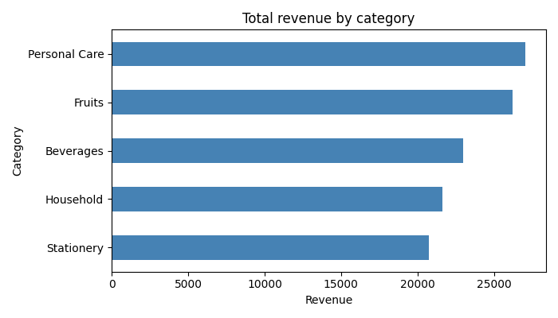
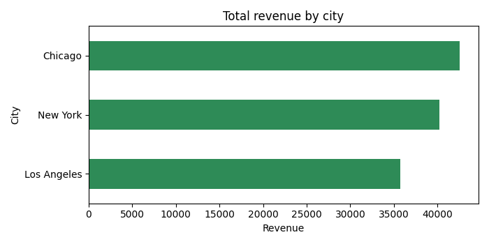
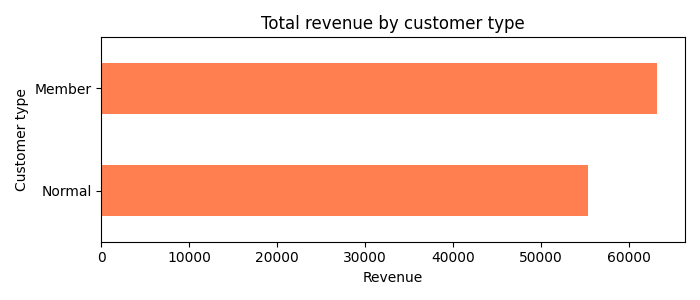

# Sales Analysis — SuperMarket Sales

## 1. Context & Objective
This project explores a dataset of **1,000 transactions** from a supermarket chain across three cities (**Chicago**, **New York**, and **Los Angeles**).  
The goal is to identify the main revenue drivers across **cities**, **product categories**, and **customer segments** in order to provide practical business recommendations.

---

## 2. Data & Quality Check
* **Source:** 
  * For this study case, I will use Supermarket sales data (1,000 rows, 12 columns) published on Kaggle. 
* **Data Audit:**
  * Zero missing values ( 0 nulls across all 12 columns).
  * Zero duplicate rows.
  * Financial consistency verified: `total_price = (unit_price * quantity) + tax` holds across 100% of transactions.
* **Overall Metrics:**
  * **Total Revenue:** $118,583.90
  * **Average Basket Value (AOV):** $118.58

---

## 3. Key Findings

### A. Performance by City
* **Chicago** leads in total revenue (**$42,584.71**, or **35.9%** of total sales), even though **New York** records slightly more transactions (**344** vs. **330**).
* This is driven by a **higher average order value in Chicago ($129.04)** compared to **New York ($116.94)** and **Los Angeles ($109.73)**.

### B. Performance by Product Category
* **Personal Care** generates the highest revenue (**$27,050.18** — **$130.05** average order value), just ahead of **Fruits** (**$26,197.45**), which leads in transaction count (**209** vs. **208**).
* **Stationery** ranks lowest in both revenue (**$20,737.11**) and average order value (**$104.73**).

### C. Customer Profile (customer_type & gender)
* **Customer Type (`Member` vs. `Normal`):** **Member** customers account for **516 transactions** and **$63,213.63** in revenue (**$122.51** average order value) and earn an average of **11.74 reward points** (**6,057** total), compared to **484 transactions**, **$55,370.27** in revenue, and a **$114.40** average order value for **Normal** customers (0 points).
* **Gender (`Male` vs. `Female`):** **Male** customers generate **$64,318.45** across **528 transactions** (**$121.82** average order value), compared to **$54,265.45** across **472 transactions** (**$114.97** average order value) for **Female** customers.

---

## 4. Visualizations

---

## 5. Recommendations
1. **Bench New York and Los Angeles against Chicago:** review basket composition and merchandising in Chicago to lift average order value (+$12 to +$19 gap) in the other two cities.
2. **Promote cross-selling on lower-AOV categories:** bundle or highlight **Stationery** ($104.73) and **Household** ($109.17) items alongside high-performing categories like **Personal Care** or **Fruits**.
3. **Boost `Member` conversions:** Members spend **$8.11 more** per transaction on average and earn reward points — offering a targeted sign-up perk on larger *Normal* purchases can help convert one-off shoppers.

---

## 6. Tools Used
* **Python** (pandas, matplotlib)
* **Environment:** Google Colab
